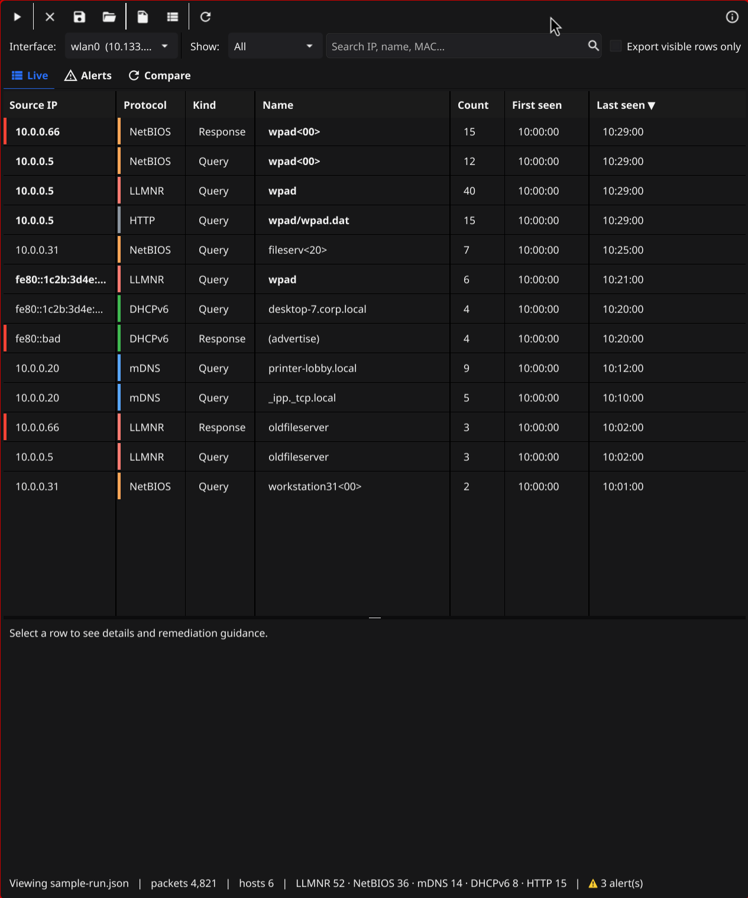
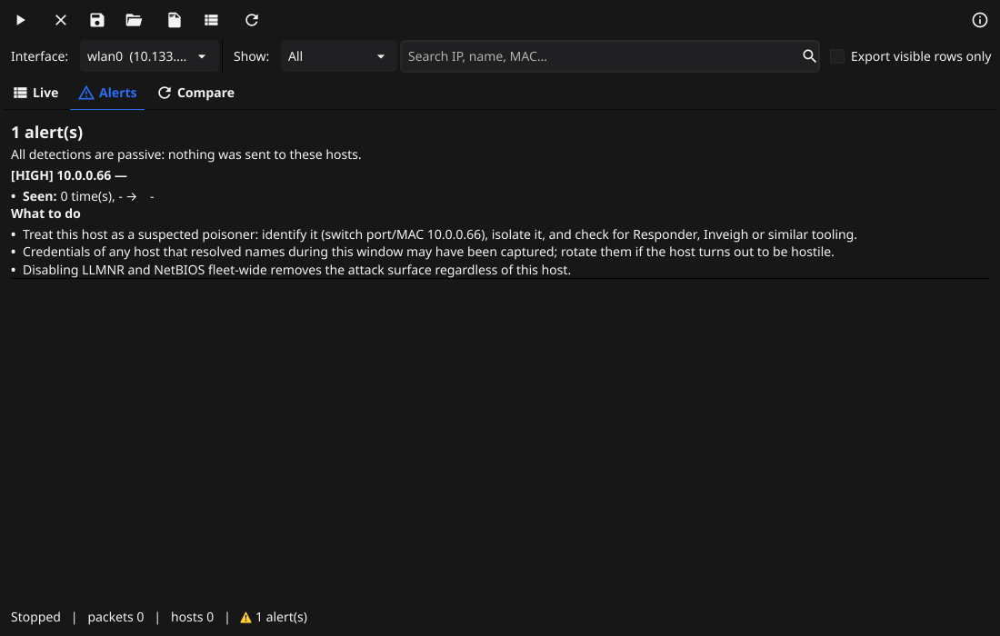
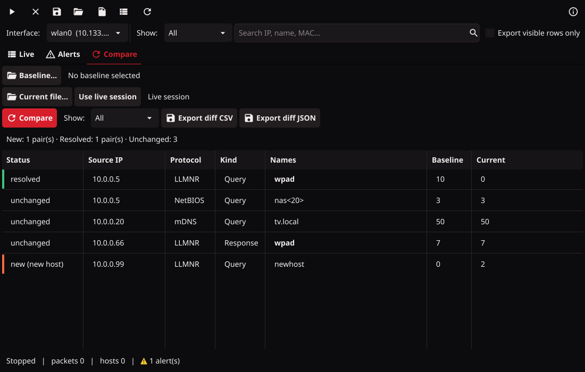

# Heimdall Listener

Heimdall Listener is a **passive** network monitor for system administrators. It shows which hosts on a
network segment still use the legacy name-resolution protocols and auto-discovery mechanisms that attack
tools such as **Responder**, **Inveigh**, **mitm6** and **ntlmrelayx** abuse to capture or relay
credentials, so you can turn those protocols off and prove that you did.

It comes as two programs that share the same engine:

| Program | For | Capture backend |
|---|---|---|
| `heimdall-listener` | Workstations with a desktop: GUI, live table, compare runs | libpcap / Npcap |
| `heimdall-cli` | Headless servers, cloud VMs, Windows Server Core, scheduled sensors | Linux: pure Go (static binary, no libpcap needed). Windows: Npcap |

**Nothing is ever transmitted.** Both programs only open the interface for reading. No probes, no
canary lookups, no responses.



## What it detects

| Traffic | Why it matters | Abused by |
|---|---|---|
| **LLMNR** queries (udp/5355, IPv4 and IPv6) | Windows falls back to LLMNR when DNS fails; anyone on the segment can answer and harvest NTLM credentials | Responder, Inveigh, ntlmrelayx |
| **NetBIOS Name Service** queries and registrations (udp/137) | Same fallback as LLMNR; broadcast to the whole subnet | Responder, Inveigh |
| **mDNS** queries (udp/5353, IPv4 and IPv6) | Windows 10+ also falls back to mDNS; answers are trusted from any host | Responder, Inveigh |
| **WPAD** lookups over LLMNR/NetBIOS/mDNS/DNS and HTTP `wpad.dat` fetches | A poisoned proxy auto-config lets the attacker demand credentials from every browser and service on the host | Responder (WPAD), ntlmrelayx |
| **DHCPv6** Solicit (udp/546→547) | Windows asks for DHCPv6 even on IPv4-only networks and accepts the first answer, which becomes its DNS server | mitm6 |

Results are **aggregated per host, protocol and name** with counts and first/last seen times, instead of one
row per packet. NetBIOS names are shown with their suffix, e.g. `fileserver<20>`.

### Passive poisoner detection

Because the engine also decodes *responses*, it flags hosts that behave like an attacker, without sending
a single packet:

| Alert | Trigger |
|---|---|
| `llmnr-nbns-responder` | A host answers LLMNR/NetBIOS for a **WPAD** name (high), for **3+ different names** within 10 minutes (high), or for a name nobody was seen asking for (medium) |
| `mdns-responder` | A host answers mDNS for a WPAD name (medium) or for 5+ different names (low; Bonjour reflectors do this legitimately) |
| `dhcpv6-server` | Any host sends DHCPv6 Advertise/Reply and is not listed with `--trusted-dhcpv6` (high: the mitm6 signature) |
| `wpad-http-server` | A host serves `wpad.dat` (info), escalated to high when the same host also answered name lookups |

Visibility caveat: LLMNR, NetBIOS and DHCPv6 *responses* are unicast to the victim. On a switched network
the sensor only sees responses to its own lookups unless it listens on a mirror/SPAN port or an unswitched
segment. mDNS responses are multicast and always visible.

## Installation

Download the binaries from the [releases page](https://github.com/ZerkerEOD/heimdall-listener/releases):

| File | Notes |
|---|---|
| `heimdall-listener-windows-amd64.exe` | GUI. Requires [Npcap](https://npcap.com) (also installed by Wireshark). Run as Administrator. |
| `heimdall-listener-linux-amd64` | GUI. Requires `libpcap` (`apt install libpcap0.8` or equivalent). Grant it capture rights with `setcap` (below) and run it as your normal user; do **not** `sudo` a desktop app, it loses access to your display. |
| `heimdall-cli-linux-amd64`, `heimdall-cli-linux-arm64` | Headless. **Static binary, nothing to install.** Run with `sudo` or grant it `CAP_NET_RAW`. |
| `heimdall-cli-windows-amd64.exe` | Headless. Requires Npcap. Run from an elevated prompt. |
| `SHA256SUMS` | Checksums for all of the above. |

Or build from source with Go 1.25+ (`libpcap-dev` is needed only for the GUI):

```sh
go install github.com/ZerkerEOD/heimdall-listener/cmd/heimdall-cli@latest       # headless, pure Go on Linux
go install github.com/ZerkerEOD/heimdall-listener/cmd/heimdall-listener@latest  # GUI, needs libpcap-dev and cgo
```

Capturing needs elevated privileges on every platform. On Linux grant them to the binaries once instead of
using `sudo` (required for the GUI, since a desktop app started with `sudo` cannot reach your Wayland/X
session; convenient for the CLI). Repeat after replacing a binary:

```sh
sudo setcap cap_net_raw,cap_net_admin+eip /usr/local/bin/heimdall-listener
sudo setcap cap_net_raw,cap_net_admin+eip /usr/local/bin/heimdall-cli
```

Viewing a saved run in the GUI needs no privileges at all (`heimdall-listener run.json`).

## Documentation

- [GUI tour](docs/GUI.md): every toolbar icon, control, tab and column explained.
- [CLI reference](docs/CLI.md): all commands, flags, output formats and exit codes.
- `heimdall-cli <command> --help` prints the same information on the command line, and
  `heimdall-cli completion bash|zsh|fish|powershell` generates shell completion.

## Using the GUI

1. Pick the interface in the top-left selector and press **▶**. Let it run for a while: hosts only show
   up when they broadcast, so a quiet network needs time.
2. The table updates live. Click a column header to sort, use **Show** to filter by protocol, **WPAD** or
   **Alerts**, and the search box to filter by IP, name or MAC. Click a row for details and the exact
   Group Policy / registry / firewall steps to turn that protocol off on that host.
3. Press **■** to stop. **✕** clears the results (it asks first if they are unsaved).
4. **Save run** writes a JSON run file. **Export** writes a CSV of the rows or a per-host remediation
   report (text). Tick *Export visible rows only* to export just what the current filter shows.
5. **Open run** loads a saved file (or start the program with the file as an argument).

**Alerts** are hard to miss: the Alerts tab shows a count badge (red icon when something is HIGH), a red
banner appears above the tabs with the newest high/medium alert and a *Show alerts* button, the affected
host's rows get a red marker, and your desktop gets a notification the first time each alert is raised.
The Alerts tab itself lists every detection with evidence and what to do about it.



### Comparing runs

Save a run before you change anything, remediate, capture again, then open the **Compare** tab: pick the
baseline file and compare it against the live session or a second file. Pairs of (host, protocol) that
disappeared are **resolved**; new pairs and new hosts are highlighted; unchanged pairs show which names were
added (+) or went away (-). The diff can be exported as CSV or JSON for a change ticket.



## Using the CLI (headless servers)

```text
heimdall-cli interfaces                          list capturable interfaces
heimdall-cli capture -i eth0                     live table until Ctrl-C, then a remediation summary
heimdall-cli capture -i eth0 -d 1h -o baseline.json --csv baseline.csv --summary baseline.txt
heimdall-cli capture -i eth0 --jsonl --quiet     one JSON line per event (for logs / SIEM)
heimdall-cli diff baseline.json after.json       what appeared, what was resolved, what persists
heimdall-cli export after.json --format summary  render a saved run (csv | summary | summary-csv | json)
heimdall-cli version                             version and capture backend
```

Alerts show up in a red block at the top of the live view as soon as they are raised, and are repeated on
stderr after the capture ends (even with `--quiet`). `capture` exits with status 3 when a HIGH alert was
raised, 2 when capture privileges are missing, so scripts can react. Use `--no-color` (or `NO_COLOR`) for
plain output.

Full flag tables, output formats and exit codes are in [docs/CLI.md](docs/CLI.md).

`capture` accepts `-i` more than once to listen on several interfaces at the same time. On Windows the
interface can be given by its friendly name (`-i "Ethernet 2"`). When stdout is not a terminal the live table
is replaced by a status line every minute (`--status-every`). Exit code 2 means the process lacks capture
privileges; the message tells you how to fix it on that OS.

A typical remediation loop:

```sh
sudo heimdall-cli capture -i eth0 -d 30m -o before.json --summary before.txt
#  ... disable LLMNR / NetBIOS via GPO, fix the wpad DNS record ...
sudo heimdall-cli capture -i eth0 -d 30m -o after.json
heimdall-cli diff before.json after.json
```

Run files are plain JSON (`schema_version` 1) and can be opened in the GUI on your workstation.

### Running as a service

`heimdall-cli service run` keeps capturing and writes `run-<UTC stamp>.json` snapshots plus a `latest.json`
into the output directory at a fixed interval (default every 5 minutes, keeping the last 48). Add
`--rollover 24h` to start a fresh aggregation every day instead of accumulating forever.

Linux (systemd):

```sh
sudo heimdall-cli service install -i eth0 --snapshot-interval 15m
sudo systemctl daemon-reload && sudo systemctl enable --now heimdall-listener
ls /var/lib/heimdall-listener/
```

The unit runs as a dynamic, unprivileged user with only `CAP_NET_RAW` and `CAP_NET_ADMIN`, writes under
`/var/lib/heimdall-listener` (its `StateDirectory`), and is sandboxed with `ProtectSystem=strict`. If you
pass a different `--out-dir`, keep it under that state directory or relax the unit.

Windows (elevated prompt, Npcap installed):

```text
heimdall-cli.exe service install -i "Ethernet0" --snapshot-interval 15m
sc start heimdall-listener
dir %ProgramData%\HeimdallListener
```

The service starts automatically, depends on the Npcap driver, logs start/stop events to the Windows Event
Log and to `heimdall.log` in the output directory, and restarts on failure.
`heimdall-cli service uninstall` removes the registration; snapshots are kept.

## Self-test

`scripts/gen-test-traffic.py` is a small test harness (not part of the listener) that transmits the
lookups the tool is meant to catch, so you can verify a sensor on your own segment in a minute:

```sh
heimdall-cli capture -i eth0 -d 30s -o test.json             # terminal 1: start listening first
python3 scripts/gen-test-traffic.py eth0 full                # terminal 2, while the capture runs
heimdall-cli export test.json                                # LLMNR, NetBIOS, mDNS and DHCPv6 rows from this host
python3 scripts/gen-test-traffic.py eth0 responder           # during a second capture: raises llmnr-nbns-responder
```

`full` must run while a capture is already listening. `responder` makes *this* machine look like a
poisoner, so the alert names this machine's own IP, not the gateway it answered to.

## Cloud and virtual networks

Azure VNets and AWS VPCs do **not** forward broadcast or multicast traffic. A sensor on a cloud VM therefore
only sees the VM's *own* LLMNR/NetBIOS/mDNS/DHCPv6 requests and its unicast DNS/WPAD lookups. That is still
useful for proving that a server image is clean and that proxy auto-detection is off, but it will not show
you what other VMs in the subnet are doing. On-premises, VLANs and hypervisor virtual switches behave like
normal segments.

If mDNS is repeated across VLANs for IoT devices, the source IP you see is the gateway or firewall doing
the repeating. There is no way to recover the original host from the repeated packet; capture on the
original VLAN instead.

## Limitations

- Capture is passive and limited to the broadcast domain of the interface (or what a SPAN port mirrors).
- HTTP `wpad.dat` detection inspects the first segment of plain HTTP on tcp/80 only.
- The pure-Go Linux backend does not follow IPv6 extension headers and only supports the default filter;
  pass `--filter` only with the libpcap-based binaries.
- Alert thresholds are deliberately conservative and are labelled as *suspected*; verify before acting.

## Building

```sh
make test                     # unit tests (race detector)
make cli-linux-amd64          # static CLI
make cli-windows-amd64        # CLI for Windows (pure Go)
make gui-linux                # GUI for Linux (needs libpcap-dev, libgl1-mesa-dev, xorg-dev)
make gui-windows              # GUI for Windows, cross-compiled (needs gcc-mingw-w64 and `make tools`)
make dist                     # everything plus SHA256SUMS in dist/
```

CI runs vet, tests and all builds on every push; tagged `v*` releases are built and published by GitHub
Actions.

## Disclaimer

This software is provided "as is" without any warranty of any kind. It identifies traffic patterns that
*usually* indicate a weakness or an attack; it can miss traffic and it can flag legitimate devices. Verify
findings before acting on them. Use at your own risk.

## Bug reports, feature requests and donations

Issues and pull requests are welcome; this is a side project worked on as time allows. If it helped you
disable a legacy protocol before a pentest or red team found it, a coffee is appreciated:

[](https://www.paypal.com/donate/?hosted_button_id=6KT8R6AA7YJBS)
