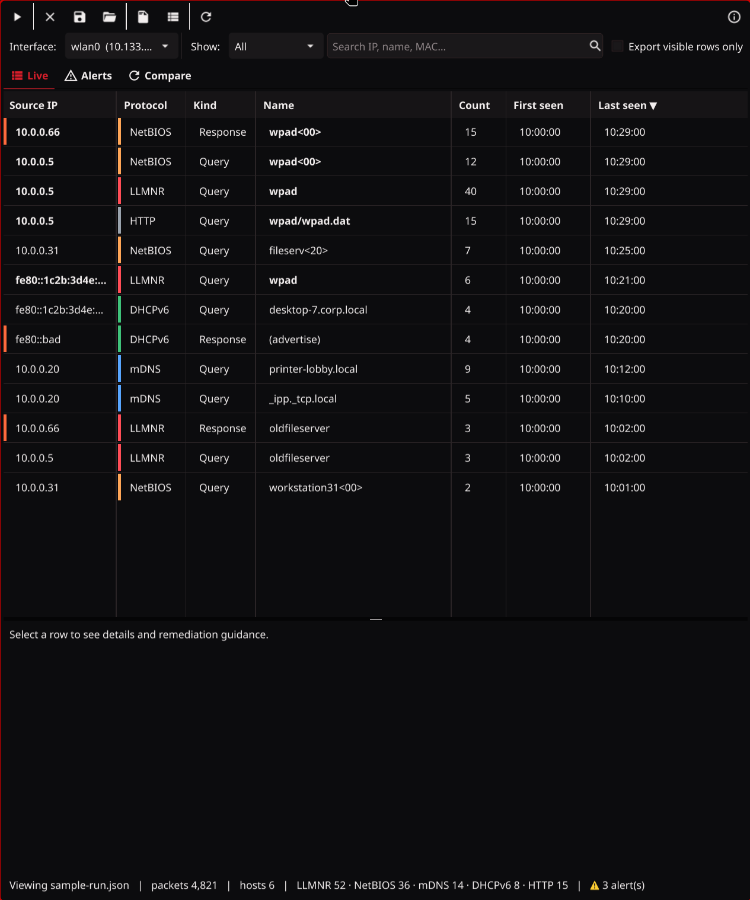

# Heimdall Listener GUI tour

The desktop application has one window with a toolbar, a controls row, an alert banner (hidden until
needed), three tabs and a status bar. Nothing it does transmits a packet.

## Toolbar (top row, left to right)

| Icon | Action | Notes |
|---|---|---|
| ▶ / ■ | **Start / Stop capture** on the selected interface | The icon flips while capturing. The interface selector is locked during a capture |
| ✕ | **Clear** results | Stops the capture if running. Asks first if there are unsaved results. Also returns from "viewing a file" to a fresh live session |
| 💾 (save) | **Save run** | Writes a JSON run file (default name `heimdall-run-<date>-<time>.json`). This is the file `heimdall-cli diff` and the Compare tab use |
| 📂 (folder) | **Open run** | Loads a saved run read-only ("Viewing <file>" in the status bar). Start a new capture with ✕ first |
| 📄 (file) | **Export CSV** | One row per aggregated entry |
| ☰ (list) | **Export summary** | The per-host remediation report as text |
| ↻ (refresh) | **Compare** | Jumps to the Compare tab |
| ⓘ (info, far right) | **About** | Version, capture backend, and the passive-only statement |

You can also open a run file by starting the program with it as an argument:
`heimdall-listener run.json` (no privileges needed for viewing).

## Controls row

- **Interface**: pick the interface to listen on. The last choice is remembered. Only usable interfaces
  (up, not loopback, with a routable address) are listed.
- **Show**: filter the table. `All`, one protocol (`LLMNR`, `NetBIOS`, `mDNS`, `DNS`, `DHCPv6`,
  `HTTP`), `WPAD` (anything WPAD-related), or `Alerts` (only hosts that have an alert).
- **Search box**: live text filter on source IP, name, MAC, protocol and answered addresses.
- **Export visible rows only**: when ticked, CSV and summary exports contain just what the table shows
  after filtering; otherwise everything captured. The Save run action always saves everything.

## Alert banner

Appears between the controls and the tabs as soon as a HIGH or MEDIUM alert exists:
`⚠ N alert(s), newest: [HIGH] 10.0.0.66 Answered a WPAD name lookup`, with a **Show alerts** button.
The first time each alert is raised you also get a desktop notification. LOW and INFO alerts only
count in the tab badge.

## Live tab

The table has one row per **host + protocol + kind + name**, not one per packet.

| Column | Meaning |
|---|---|
| Source IP | The host that sent the packet. A red marker on this cell means the host has an alert. Bold means WPAD-related |
| Protocol | LLMNR, NetBIOS, mDNS, DNS, DHCPv6 or HTTP, with a colour stripe per protocol |
| Kind | `Query` (the host asked for something) or `Response` (the host answered or offered something) |
| Name | The name involved. NetBIOS names carry their suffix (`fileserver<20>`); DHCPv6 shows the client FQDN or the message type; HTTP shows `host/wpad.dat`. Bold means WPAD-related |
| Count | How many times this was seen |
| First seen / Last seen | Local time of the first and latest packet |

- Click a **column header** to sort; click again to reverse. The arrow shows the current sort. The
  default is newest first.
- Click a **row** to open it in the detail pane below the table. The selection survives refreshes and
  re-sorting.
- The **detail pane** shows the full record (MAC, query types, answered addresses, both local and UTC
  timestamps, the last packet's description, the NetBIOS suffix meaning), any alerts for that host, why
  the protocol matters, and the exact Group Policy / registry / firewall steps to turn it off.
- Drag the divider between table and detail pane to resize.

The table refreshes four times a second while capturing; the status bar once a second.

## Alerts tab

The tab title shows the count, e.g. `Alerts (3)`, with a red icon when any alert is HIGH. The page lists
every passive detection: severity, host, title, evidence sentence, the names involved, how often and when
it was seen, and what to do about it. Rules:

| Rule | Fires when |
|---|---|
| `llmnr-nbns-responder` | A host answers LLMNR/NetBIOS for a WPAD name (HIGH), for 3+ different names in 10 minutes (HIGH), or for a name nobody was seen asking (MEDIUM) |
| `mdns-responder` | A host answers mDNS for a WPAD name (MEDIUM) or for 5+ different names (LOW) |
| `dhcpv6-server` | A host sends DHCPv6 Advertise/Reply (HIGH), unless listed as trusted |
| `wpad-http-server` | A host serves `wpad.dat` (INFO), HIGH when it also answered name lookups |

## Compare tab

1. **Baseline…** picks the saved run from before your change.
2. **Current** is the live session by default (**Use live session**), or a second file (**Current file…**).
3. **Compare** fills the table. **Show** filters it to New, Resolved or Unchanged.

| Status | Meaning |
|---|---|
| `resolved` (green stripe) | In the baseline, gone now: the remediation worked |
| `new` (red stripe) | Not in the baseline. `(new host)` if the host itself is new |
| `unchanged` | In both. Names added since the baseline are prefixed `+`, names gone `-` |

The summary line counts pairs, hosts, WPAD pairs and alerts new/cleared. **Export diff CSV / JSON** save
the comparison for a change ticket.

## Status bar

`● Capturing on wlan0 (libpcap) | 00:12:31 | packets 12,345 | hosts 17 | LLMNR 120 · NetBIOS 44 | ⚠ 2 alert(s)`.
It reads `Stopped`, `Starting`, `● Capturing on …` or `Viewing <file>`. Kernel drops appear here if the
host cannot keep up.

## Closing

Closing the window with unsaved results asks for confirmation. Window size and the chosen interface are
remembered between runs.
